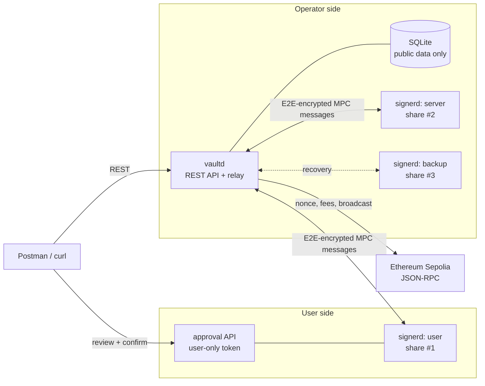

# ThresholdVault

**A 2-of-3 MPC wallet backend in Go.** Three independent signer processes
each hold one share of a secp256k1 key. Any two of them can sign a
transaction together; the full private key never exists anywhere: not
during key generation, not during signing, not in tests.

> ⚠️ **Testnet only. Unaudited. A portfolio demo, not a product.** Do not use
> with real funds. See [Security and custody limitations](#security-and-custody-limitations).

## What it demonstrates

- **Real threshold ECDSA:** distributed key generation and 2-of-3 signing
  with [`bnb-chain/tss-lib` v2](https://github.com/bnb-chain/tss-lib)
  (GG18/GG20, including the TSSHOCK fixes). No mocked cryptography and no
  home-made primitives.
- **Three separate signer processes** (`user`, `server`, `backup`). Each
  keeps only its own share, encrypted at rest with AES-256-GCM and Argon2id.
- **An untrusted coordinator.** Signers talk through a relay hosted by the
  coordinator, but every message is end-to-end encrypted (NaCl box), signed
  (Ed25519) and replay-protected. The relay can only drop messages.
- **User-controlled approval.** The user signer decodes each transaction
  *itself*, shows recipient, amount and fee, and signs only after the user
  confirms. The server signer co-signs only with the user's signed approval.
  No signer ever signs a bare hash.
- **Chain adapters** for six testnets, with address and encoding test vectors.

## Status

What works today, and how it is verified:

| Area | Status | Verified by |
|---|---|---|
| 2-of-3 DKG + threshold ECDSA | ✅ Working | All three signer pairs sign; signatures checked by ECDSA verify and public-key recovery |
| A single share can't sign | ✅ Demonstrated | Four independent tests (quorum, share ≠ key, raw-share signature fails, lone party times out) |
| Encrypted, separate share storage | ✅ Working | Tamper, swap and wrong-passphrase tests |
| Three signer processes + E2E-encrypted relay | ✅ Working | End-to-end test spawns real `vaultd` + 3 × `signerd` processes |
| User review / approval / co-signing policies | ✅ Working | Tests for unapproved, altered and mismatched transactions |
| Wallet creation + addresses on 6 chains | ✅ Working | Published test vectors (BIP-173, TRON docs, Ethereum key-1) |
| Ethereum: build, sign, broadcast | ✅ Working on a simulated chain | Full flow mined on go-ethereum's in-memory chain |
| Ethereum Sepolia live broadcast | 🟡 Implemented, not yet demonstrated live | Needs an RPC URL and test ETH |
| ERC-20 transfer encoding | ✅ Working | Byte-for-byte against go-ethereum's ABI encoder |
| Token contract configuration (USDC/USDT) | ⏳ Planned | |
| BSC testnet transactions | ⏳ Planned (same EVM adapter) | |
| Bitcoin / Litecoin / Dash transactions | ⏳ Planned (test vectors only) | |
| TRON + TRC-20 USDT transactions | ⏳ Planned (test vectors only) | |
| CLI, Docker Compose, CI | ⏳ Planned | |

TRON USDC is intentionally not supported: Circle discontinued native USDC
issuance on TRON.

## Architecture



- **`vaultd`** (coordinator) serves the REST API, stores wallets and
  transactions in SQLite, builds unsigned transactions and relays MPC
  messages. **It holds no key material** and can't sign or approve anything.
- **`signerd`** runs once per role. The **user** signer represents the
  user's device; **server** co-signs routine transfers; **backup** is the
  recovery share.

Full design, trust model and diagrams: **[docs/ARCHITECTURE.md](docs/ARCHITECTURE.md)**.

### How a transfer is authorized

```
prepare ──► user signer decodes the raw tx itself ──► user confirms
        ──► approval token (Ed25519, bound to tx id + sighash)
        ──► user + server run 2-of-3 signing; each re-checks tx and approval
        ──► broadcast
```

If anyone changes the transaction after the user approved it, its sighash
changes and every signer refuses.

## Quick start

**Requirements:** Go 1.27+. Everything is pure Go: no C toolchain, no
Docker needed.

```bash
git clone https://github.com/ArthurMartiros/MPC_TSS_wallets.git
cd MPC_TSS_wallets

cp .env.example .env      # optional: add SEPOLIA_RPC_URL for live features
scripts/dev.sh            # builds and starts vaultd + 3 signers
```

Keep that terminal open; press Ctrl+C to stop everything.
`scripts/dev.sh --reset` wipes local data.

### Create a wallet

```bash
curl -s -X POST localhost:8080/wallets \
  -H "Authorization: Bearer dev-api-token" \
  -d '{"name":"treasury"}'
```

This runs distributed key generation across the three signers. The first
wallet takes 10–60 s while each signer generates safe primes; later ones
take a few seconds. Real output (trimmed):

```json
{
  "id": "w_78656073a785fdb4df60",
  "name": "treasury",
  "public_key": "027d69a719f997acc52e870905a66196fde059e0a3e36c190030caeda989098e7b",
  "addresses": [
    { "chain": "bitcoin-testnet",  "address": "tb1qf9h74l649n8094jyefvta7e2uwcqfnuad0kpcp" },
    { "chain": "bsc-testnet",      "address": "0xF49aBf16B757e555Dda89589cB3918c6AD638444" },
    { "chain": "dash-testnet",     "address": "yT1kFQK9nxJqu6U9RBLG45ypYvxDVzmekf" },
    { "chain": "ethereum-sepolia", "address": "0xF49aBf16B757e555Dda89589cB3918c6AD638444" },
    { "chain": "litecoin-testnet", "address": "tltc1qf9h74l649n8094jyefvta7e2uwcqfnua585lgg" },
    { "chain": "tron-nile",        "address": "TYGZFqVE7kPBjo6apVy29QbspjGfjXZZge" }
  ]
}
```

Each signer's data directory now holds only its own encrypted share
(`data/dev/<role>/share/<wallet>.enc`).

### Send Sepolia ETH

Requires `SEPOLIA_RPC_URL` in `.env` and test ETH sent to the wallet's
`ethereum-sepolia` address (from any Sepolia faucet).

```bash
API="Authorization: Bearer dev-api-token"
APPROVE="Authorization: Bearer dev-approval-token"   # user-only

# 1. Coordinator builds the unsigned transaction (live nonce + EIP-1559 fees)
curl -s -X POST localhost:8080/transactions/prepare -H "$API" -d '{
  "wallet_id": "<wallet id>", "chain": "ethereum-sepolia",
  "asset": "ETH", "to": "<recipient>", "amount": "0.001"}'
#  -> { "id": "<tx id>", "status": "prepared", "unsigned_tx": "<hex>", ... }

# 2. USER: the user signer decodes it independently. Check the summary!
curl -s -X POST localhost:7101/v1/approvals/review -H "$APPROVE" -d '{
  "tx_id": "<tx id>", "wallet_id": "<wallet id>",
  "chain": "ethereum-sepolia", "transaction": "<unsigned_tx hex>"}'
#  -> { "from": "...", "summary": { "to": "...", "amount_display": "0.001 ETH",
#       "max_fee_display": "...", "sighash": "<sighash>" } }

# 3. USER: confirm, which returns a signed approval token
curl -s -X POST localhost:7101/v1/approvals/confirm -H "$APPROVE" \
  -d '{"tx_id": "<tx id>", "sighash": "<sighash>"}'

# 4. Hand the approval to the coordinator, then sign and broadcast
curl -s -X POST localhost:8080/transactions/<tx id>/approve -H "$API" -d '{"approval": "<token>"}'
curl -s -X POST localhost:8080/transactions/<tx id>/sign      -H "$API"
curl -s -X POST localhost:8080/transactions/<tx id>/broadcast -H "$API"
#  -> { "status": "broadcast", "tx_hash": "0x...", "explorer_url": "https://sepolia.etherscan.io/tx/0x..." }
```

Easier: import **[docs/api/ThresholdVault.postman_collection.json](docs/api/ThresholdVault.postman_collection.json)**
into Postman and run the *Transactions* folder top to bottom. It passes IDs
and tokens between steps automatically.

## Configuration

`scripts/dev.sh` reads `.env` (see [`.env.example`](.env.example)).
Variables set on the command line override it.

| Variable | Default | Purpose |
|---|---|---|
| `SEPOLIA_RPC_URL` | *(empty)* | Sepolia JSON-RPC; enables balances, prepare, broadcast |
| `BSC_TESTNET_RPC_URL` | *(empty)* | BSC testnet JSON-RPC |
| `API_TOKEN` | `dev-api-token` | Bearer token for the REST API |
| `SIGNER_TOKEN` | `dev-signer-token` | Coordinator → signer token |
| `APPROVAL_TOKEN` | `dev-approval-token` | User-only approval API token |
| `API_PORT` / `APPROVAL_PORT` | `8080` / `7101` | Ports |
| `DATA` | `./data/dev` | Database, encrypted shares, identities |

The binaries also take flags (`./bin/vaultd -h`, `./bin/signerd -h`).

## API

Coordinator (`vaultd`, bearer token `API_TOKEN`):

| Method | Path | Description |
|---|---|---|
| `POST` | `/wallets` | Create a wallet (runs DKG) |
| `GET` | `/wallets` | List wallets |
| `GET` | `/wallets/{id}` | Wallet with addresses |
| `GET` | `/wallets/{id}/balance?chain=&asset=` | Balance (chains with an RPC) |
| `POST` | `/transactions/prepare` | Build an unsigned transfer |
| `POST` | `/transactions/{id}/approve` | Attach the user's approval token |
| `POST` | `/transactions/{id}/sign` | 2-of-3 threshold signing |
| `POST` | `/transactions/{id}/broadcast` | Send to the network |
| `GET` | `/transactions[?wallet_id=]`, `/transactions/{id}` | Status, refreshed from chain |
| `GET` | `/signers`, `/chains`, `/healthz` | Signer reachability, chains, liveness |

User signer approval API (port `7101`, bearer token `APPROVAL_TOKEN`, never
given to the coordinator): `POST /v1/approvals/review`,
`POST /v1/approvals/confirm`.

Transaction states: `prepared → approved → signing → signed → broadcast →
confirmed | failed`. Out-of-order calls return `409`.

## Testing

```bash
go test ./...          # ~1 minute; all packages
go test -short ./...   # skips the multi-process end-to-end test
```

About 5,300 lines of Go and 2,900 lines of tests (66 test functions),
including:

- **MPC**: DKG consistency, every 2-of-3 signer pair, leading-zero digests,
  single-share failure, signers that disagree on the message abort
- **Relay**: a malicious relay that tampers with, replays, forges or
  redirects messages is rejected
- **Policies**: unapproved, altered-after-approval and bare-digest requests
  are refused by every signer
- **Chains**: address vectors, strict EIP-1559 decoding, ERC-20 encoding vs
  the ABI encoder, and a full transfer on go-ethereum's simulated chain
- **End to end**: real `vaultd` + three `signerd` processes, including a
  signer restart

Pre-parameter files in `internal/mpc/testdata/` are test-only fixtures (safe
primes take minutes to generate), so the suite runs fast.

## Project layout

```
cmd/vaultd/             coordinator: REST API, SQLite, relay
cmd/signerd/            signer node (user | server | backup)
internal/mpc/           tss-lib wrapper: keygen, signing, key shares
internal/sharestore/    encrypted per-signer storage
internal/identity/      signer identities (Ed25519 + X25519)
internal/relay/         untrusted mailbox relay + E2E-encrypted transport
internal/signer/        signer service, policies, approval API
internal/approval/      user approval tokens
internal/chain/         chain adapters: evm, utxo, tron, networks registry
internal/coordinator/   wallet and transaction orchestration
internal/store/         SQLite persistence
internal/api/           HTTP handlers
test/e2e/               multi-process end-to-end test
docs/                   architecture, Postman collection
```

## Security and custody limitations

This project demonstrates the architecture of MPC custody. It is **not**
production custody software:

- **Unaudited.** Neither this code nor its integration of tss-lib has been
  reviewed by a third party. tss-lib itself has had audits.
- **Testnet only.** Chain IDs and addresses are testnet; there is no mainnet
  configuration.
- **No HSM or secure enclave.** Shares are encrypted with a passphrase on
  disk. A compromised signer host can read its share while running.
- **Single host in the demo.** `scripts/dev.sh` runs all three signers on
  one machine with fixed development tokens and passphrases, which defeats
  the point of separating them. Real deployments put each share on a
  separate device or operator.
- **Trust-on-first-use peer pinning.** Signers pin each other's identity
  keys from a shared directory the first time they see them. Production
  would exchange fingerprints out of band.
- **No key refresh or resharing**, and no way to rotate a compromised share
  without moving funds to a new wallet.
- **Minimal policy engine.** Beyond user approval there are no limits,
  allowlists or velocity checks.
- **Availability, not safety, is what a malicious coordinator can attack.**
  It can drop messages or refuse service, but it can't sign or alter what
  the user approved.
- **The backup share** follows the same co-signer policy (it requires the
  user's approval); a real recovery procedure is out of scope.

## Roadmap

- Verified token configuration (Sepolia USDC; on-chain `decimals()`/`symbol()` check)
- BSC testnet transactions (BNB, USDT, USDC)
- Bitcoin/Litecoin P2WPKH, Dash P2PKH and TRON/TRC-20 transaction adapters with test vectors
- `thresholdvault` CLI
- Docker Compose and GitHub Actions CI
- Live Sepolia end-to-end demonstration
