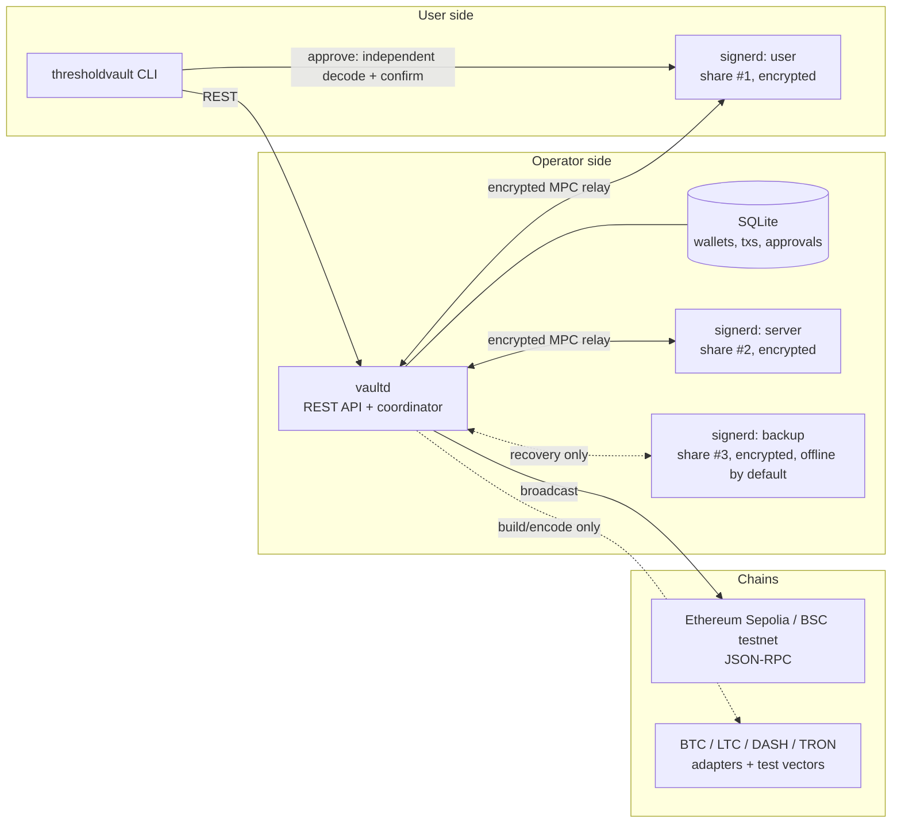
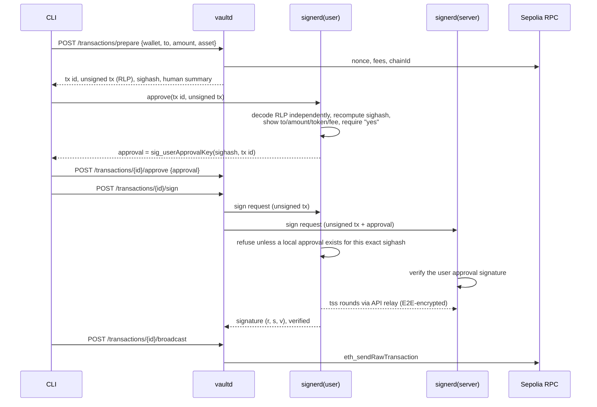

# ThresholdVault Architecture

ThresholdVault is a testnet-only demo of an MPC custody stack: **2-of-3 threshold
ECDSA** wallets on secp256k1, a coordinator that builds and relays
transactions, and three independent signer processes that each hold a single
encrypted key share. The full private key is never constructed: not during key
generation, not during signing, and not in tests.

## Components



| Component | Binary | Holds | Trust |
|-----------|--------|-------|-------|
| Coordinator | `vaultd` | wallet metadata, public keys, unsigned/signed txs, approvals | **No key material.** Treated as untrusted by signers: it can't sign alone and it can't forge user approval. |
| User signer | `signerd --role user` | share #1 (encrypted with the user's passphrase) | Runs on the user's machine. Decodes every tx itself and signs only after explicit local approval. |
| Server signer | `signerd --role server` | share #2 | Co-signs with the user signer for routine operations. Enforces policy (for example, the tx must have a valid user approval). |
| Backup signer | `signerd --role backup` | share #3 | Cold or recovery share. Lets the operator recover funds together with *either* the user or the server signer. |
| CLI | `thresholdvault` | nothing persistent | Thin client for the REST API and the local user signer. |

Any two shares can produce a signature. One share alone, including the
coordinator plus any single compromised signer, cannot.

## Threshold ECDSA library

**[`bnb-chain/tss-lib` v2](https://github.com/bnb-chain/tss-lib)** (GG18/GG20 ECDSA).

* It is the most widely deployed open-source Go threshold-ECDSA implementation
  (Binance, THORChain, and others), MIT-licensed, and has been audited.
* v2 contains the fixes for the 2023 TSSHOCK / "alpha-rays" class of attacks
  (Paillier-Blum modulus and no-small-factor proofs, SSID binding).
* It normalizes signatures to low-S and returns the recovery id, which
  Ethereum and Bitcoin both require.

Considered and rejected: `taurusgroup/multi-party-sig` (CMP; a cleaner protocol
but still tagged *alpha*). ThresholdVault does **not** implement any
cryptographic primitive itself.

tss-lib's `threshold` parameter means "t", where **t+1** parties are needed to
sign. ThresholdVault exposes the more intuitive *quorum* (2) and translates it
internally.

## MPC engine (`internal/mpc`)

```
             ┌──────────────── session ────────────────┐
 tss.Party ──► out chan ──► flush ──► Transport.Send ──► peers
   ▲                                                      │
   └── UpdateFromBytes ◄── validate sender/recipient ◄────┘
```

* A `Transport` is a per-session message bus with `Send` / `Receive`. The
  engine never assumes a network. Tests use an in-memory hub. Signer processes
  use an HTTP relay through the coordinator.
* The engine is single-threaded per session: it calls `Start`/`Update` and then
  flushes all queued outbound messages, so no protocol message can be lost
  when a party finishes.
* Party identities are fixed names (`user`, `server`, `backup`) mapped to tss
  keys 1, 2, 3. The same mapping is persisted in each share, which lets any
  2-subset sign later.
* After keygen each party checks that its own `Xi·G` matches the public share
  commitment. After signing each party verifies the signature with
  `ecdsa.Verify` **and** by recovering the public key from `(r, s, v)`.

### Secure channels

tss-lib requires its point-to-point messages (keygen round 2 carries Shamir
shares) to be **confidential and authenticated**. The coordinator relays but
must not be able to read them (`internal/relay`, `internal/identity`):

* Each signer has a long-term identity: an Ed25519 signing key and an X25519
  box key, stored encrypted next to its shares.
* **Every** message, broadcasts included, is sealed separately to each
  recipient with NaCl `box` (X25519 + XSalsa20-Poly1305), then signed with
  Ed25519 over `(session, from, to, seq, broadcast, nonce, ciphertext)`.
* Receivers accept only messages from pinned session members, for their own
  session and party, with a strictly increasing per-sender `seq`. A malicious
  relay can drop or delay messages, which makes the session time out, but it
  can't read, forge, redirect or replay them. Tests cover each of these cases.
* The relay is a dumb long-polling mailbox
  (`POST /relay/v1/sessions/{sid}/messages`,
  `GET /relay/v1/sessions/{sid}/inbox/{party}`) with memory limits and TTL.

**Identity pinning.** Each signer publishes `<name>.pub` to a peers directory
and pins the first identity it sees for each peer in its own encrypted store
(trust on first use). A later change is refused. In the Docker demo this
directory is a shared volume. A real deployment would exchange fingerprints in
an out-of-band ceremony.

**Signing authorization.** `signer.Authorizer` decides, *inside each signer*,
whether a request may be signed. The coordinator's bearer token only controls
who may ask. Signers never sign a bare digest: every sign request carries the
raw unsigned transaction, and each signer decodes it with its own chain
adapter and checks that the digest is really its sighash.

* **`user` policy (user signer).** The user signer serves a second,
  user-only **approval API** (`--approval-listen`, own `--approval-token`,
  never given to the coordinator). `POST /v1/approvals/review` decodes the
  transaction locally and shows recipient, amount, token and max fee.
  `POST /v1/approvals/confirm` (the user's explicit "yes", echoing the
  reviewed sighash) stores an approval record and returns an **approval
  token**: an Ed25519 signature by the user's identity over
  `(tx id, wallet, chain, sighash, expiry)`. When asked to sign, the user
  signer requires a local approval for exactly that sighash.
* **`cosigner` policy (server, backup).** Requires a valid approval token
  from the *pinned* user identity for exactly this transaction.

A compromised coordinator therefore can't get anything signed that the user
did not see and confirm on their own signer. Swapping the transaction after
approval changes the sighash and both policies refuse it. Tests cover these
cases.

## Share storage (`internal/sharestore`)

Each signer stores its shares in its **own** data directory, one file per
wallet:

* AES-256-GCM, with a key derived from the signer's passphrase via Argon2id
  (fresh random salt and nonce per file).
* The record name (`share/<wallet-id>`) is bound as AEAD associated data, so
  ciphertexts can't be swapped between wallets without detection.
* Writes are atomic (temp file + rename), mode `0600` in a `0700` directory.

Paillier pre-parameters (safe primes, which take seconds to minutes to
generate) are computed ahead of time by each signer and stored the same way.
Each keygen consumes a fresh set.

## Transaction flow (EVM example)



The user signer never trusts the coordinator's summary. It recomputes the
digest from the raw unsigned transaction with its own chain adapter.

## Chain adapters (`internal/chain/...`)

| Chain | Assets | Status in this demo |
|-------|--------|---------------------|
| Ethereum Sepolia | ETH, USDT, USDC (ERC-20) | Build, sign, **broadcast verified end to end** |
| BNB Smart Chain testnet | BNB, USDT, USDC (BEP-20) | Same EVM adapter, config only; tested with vectors |
| Bitcoin testnet | BTC | P2WPKH build/sighash/sign; test vectors only |
| Litecoin testnet | LTC | P2WPKH with LTC params; test vectors only |
| Dash testnet | DASH | P2PKH legacy sighash; test vectors only |
| TRON Nile/Shasta | TRX, USDT (TRC-20) | Raw-tx encoding + sighash + TRC-20 ABI; test vectors only |

TRON USDC is intentionally **not** supported: Circle discontinued native USDC
issuance on TRON.

## Repository layout

```
cmd/
  vaultd/            coordinator + REST API
  signerd/           signer node (user | server | backup)
  thresholdvault/    CLI
internal/
  mpc/               tss-lib wrapper: keygen, signing, transport, key shares
  sharestore/        encrypted per-signer storage
  identity/          signer identities (Ed25519 + X25519)
  relay/             untrusted mailbox server + E2E-encrypted transport
  signer/            signer node: pre-param pool, keygen/sign, HTTP API, client
  chain/             adapter interface; evm, utxo (btc/ltc/dash), tron; networks registry
  store/             SQLite persistence (pure-Go driver), migrations
  coordinator/       wallet/tx orchestration across signers and chains
  api/               REST handlers; mounts the relay
  testutil/          in-process signer clusters for integration tests
test/e2e/            spawns real vaultd + signerd processes
docs/
```

## Out of scope / limitations

Testnet only, unaudited, a demo. See the README's *Security and custody
limitations* section for details (no HSM, no key refresh/resharing, no policy
engine, no identifiable abort handling beyond tss-lib's culprit reporting).
